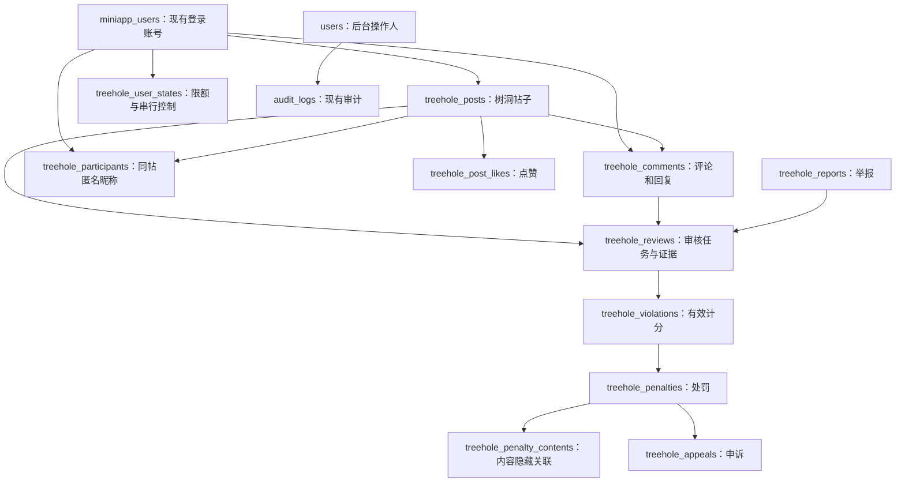

# 树洞 V1 产品与后端技术规范

- **文档版本**：V1.1
- **文档状态**：产品方案已确认；三端代码已落地并进行验收，未部署
- **最后更新**：2026-10-24
- **适用对象**：产品、小程序、后台、服务端开发与验收人员
- **当前实现**：共享 DTO、基线、独立 Mock、原生 B 页面、后台案件工作台及服务端 33 操作、11 表 migration/Schema、审核 worker、OpenAI 兼容适配和治理逻辑已落地。隔离数据库、真实 AI 调用与原生视觉验收尚未完成；代码实现不代表已部署

## 1. 目标、范围与决策优先级

树洞提供对其他用户匿名、仅允许文字、内容短期展示的交流空间。鼓励善意分享和支持，允许悲伤、抱怨、求助和合理批评；不以“是否乐观”判断违规。禁止侮辱、骚扰、威胁、隐私泄露等行为，通过代码规则、AI、人工复核、违规计分和阶梯限制维护秩序。

本文合并 grill-me / grilling 访谈与后端方案。发生调整时，以最后确认的决定为准，尤其是：

1. **学生身份、学号核验和账号绑定暂不做**。V1 直接关联现有 `miniapp_users.id`，不新增学生身份表或核验接口。
2. **取消投票、精选候选和延期保留**。所有帖子按首次公开时确定的期限消失。
3. **实际限制期间不能进入整个树洞**，包括浏览；个人中心的处罚、申诉及本人内容操作独立提供。
4. 正常服完限制不恢复旧内容；误判撤销才可能恢复未过期的正常内容。
5. 后台身份关联查询的授权范围尚待确认，V1 不开放身份查询接口。

### 1.1 首版能力边界

| 类别 | V1 范围 |
|---|---|
| 身份 | 现有正常小程序账号登录；账号维度计分、限额及处罚 |
| 内容 | 纯文字帖子、评论、回复；不支持编辑 |
| 互动 | 帖子点赞/取消点赞、举报；不做评论点赞 |
| 消失 | 作者删除；帖子首次公开后 1/6/12/24 小时到期，默认 24 小时 |
| 匿名 | 同帖固定昵称，跨帖独立；楼主标识；无匿名个人主页和跨帖历史 |
| 治理 | 规则分流、风险内容 AI 审核、人工重点审核、隐藏分数、阶梯限制、申诉 |
| 暂不做 | 学号绑定、在校/本校身份核验、投票、精选、延期、图片、附件、私信、可点击外链 |
| 待确认 | 真实账号关联查询权限；普通内容及案件证据的具体保留期限和清除策略 |
| 后续设计 | 自伤求助等特殊高风险响应流程；不承诺实时救援或紧急响应能力 |

暂缓身份核验后，不能将 V1 描述为“仅本校已核验学生可用”或“重新注册不能规避处罚”。当前只能保证同一 `miniapp_users.id` 的记录连续；不提供树洞专属清分、换号或注销重建接口。

### 1.2 已确认规则与技术补充的区别

第 2 节记录产品决定；第 3–8 节给出已确认后端方向的具体技术规范。时间边界、并发锁、枚举编码、分页和幂等等细节属于本文的实现约定，不是新增产品功能。第 10 节的待决事项不能被开发者静默补成已上线能力。

## 2. 产品行为规范

### 2.1 匿名与权限

- 必须登录且小程序账号正常；树洞有有效限制时拒绝所有树洞业务接口。
- 同一用户在同一帖子内昵称固定；离开重进、删评后再评论不重新分配身份。
- 不同帖子独立生成昵称，不使用从真实用户 ID 推导的公开编号，不提供跨帖作者标识。跨帖偶然重名不代表同一人。
- 同帖内昵称不重复；帖子作者的评论、回复显示 `isOp=true`。
- 昵称不可点击到真实社区主页；普通响应不返回作者用户 ID、社区昵称、头像、OpenID、UnionID。
- 服务端保存真实账号关联以执行治理。普通后台审核响应也不直接暴露真实账号资料；管理员按案件作决定，由服务端定位账号。
- 身份查询权限单独设计，不能因为现有后台 `role=1` 就默认开放。

### 2.2 内容、互动与期限

- 帖子正文 trim 后 1–1,000 个 Unicode 码点；评论及回复 1–500 个 Unicode 码点。前端提示与后端计数口径一致，不用 UTF-16 代码单元数代替。
- 纯文字渲染，不解释 HTML/Markdown，不将外链转成可点击链接，不接受媒体地址。
- 不允许发布可识别他人的学号、电话、住址等隐私；内容规则检测与审核处理不能宣称绝对无漏判。
- `ttlHours` 只能为 `1 | 6 | 12 | 24`，省略默认 `24`；不使用 `0`，没有永不过期选项。
- 从**首次公开**计算有效期；后续抽查、恢复或复核不能刷新 `published_at` 或延长 `expires_at`。
- 公开后不支持编辑；待审可以取消，再作为新投稿提交。帖子和评论均支持本人删除。
- 帖子到期或作者删除后，整帖、评论、回复和点赞入口一起不可访问，并从本人内容列表消失。
- 单条评论删除/处罚隐藏时，存在正常回复的地方保留占位，正文为空、显示“评论已删除”；不返回原昵称和作者标记，不连带删除其他人的正常回复。
- 从未公开的投稿超过提交时间 24 小时仍未通过则关闭，作者能看到关闭状态与原因，不会在数天后突然公开。已公开内容的复查沿用原到期时间，不重新套用投稿待审期限。

### 2.3 提交次数与幂等

| 项目 | 限制 |
|---|---|
| 每人每天帖子投稿 | 5 篇 |
| 每人每天评论与回复合计 | 50 条 |
| 两次新帖子提交间隔 | 至少 60 秒 |
| 两次新评论/回复提交间隔 | 至少 10 秒 |
| 每日边界 | `Asia/Shanghai` 的自然日；数据库时间仍保存 UTC |

合法并持久化接受的投稿计一次，待审、之后被拒绝、作者删除都不返还次数。认证/参数/频率检查失败、技术失败且事务未提交不计次。规则直接要求修改、没有接受投稿时不计次；已接受并进入审核的内容计次。网络重试通过幂等键识别，不计为新投稿。频率限制不计入违规分。

### 2.4 审核分流

用户先获得投稿已接受的结果，`pending_review` 不等于已经公开。

1. 代码规则检查长度、频率及明显内容风险。低风险可以直接公开；明显不符合提交规则的提示修改或转审。
2. 需要 AI 的内容暂不公开，持久化审核任务后异步调用；AI 通过才公开，疑似严重违规或无法判断时转人工。
3. 对部分已公开内容抽查，举报也触发复查。抽查不能使旧内容重新公开或重新计时。
4. AI 只能在约定类别、分值范围内给出判断与原文依据；服务端校验并执行规则，不接受 AI 任意修改权限、调用处罚接口或指定期限。
5. 普通负面情绪、合理批评不计分。涉及可识别个人的严重事实指控暂停公开并人工判断，AI 不直接认定“诽谤成立”。
6. AI 故障、超时、预算不足不等于内容违规；需 AI 的投稿保持待审，可由人工接手，仍遵守 24 小时待审上限。
7. 管理员试运行阶段每天至少处理一次。自伤求助等独立高风险服务流程暂缓；明确威胁仍属于已有违规审核范围。

### 2.5 违规分与处罚

内部采用从 0 开始递增的“违规分”，等价于原设想中对隐藏信用分扣分；用户不查看具体分值。以下是试运行初始规则，不代表已经实测有效。

| 违规类别 | 单次违规分 | 处理边界 |
|---|---:|---|
| 轻度侮辱、轻微针对性攻击 | 1–3 | 明确且轻微的可由 AI 按规则生效 |
| 明确辱骂、持续骚扰、重复针对个人攻击 | 4–9 | AI 提供依据；上下文有争议转人工 |
| 严重隐私泄露、明确威胁等严重行为 | 10–20 | AI 仅建议计分，先临时处置并人工确认 |
| 有事实依据的诽谤 | 4–20 | 仅人工确认，必须记录事实判断依据；不凭文本猜测事实真伪 |

| 最近 90 天有效累计分 | 等级 | 处罚 |
|---|---:|---|
| 0 | 无 | 正常 |
| 1–4 | 0 | 警告，不禁止访问，不清理其他正常内容 |
| 5–9 | 1 | 限制整个树洞 1 小时 |
| 10–19 | 2 | 限制整个树洞 24 小时 |
| 20–29 | 3 | 限制 7 天，人工确认 |
| 30–39 | 4 | 限制 30 天，人工确认 |
| ≥40 | 5 | 提交永久封禁审查，人工决定；不是自动永久封禁 |

- 以有效计分的首次 `confirmed_at` 为 90 天起点；满 90 天退出计分，复审不得刷新起点。连续 90 天无新确认违规时累计自然归零。
- 同一内容至多一笔计分，包含多种违规时采用确认的最高适用等级，不叠加多次扣分；复审可以修正这一笔，必须保留旧判断依据。
- 规则命中本身不扣分；确认违规后，即使内容未公开，也可以计分。同账号、同类型的相同规范化正文按提交时间划分固定 24 小时批次，同批只计一次；批次从首份投稿被接受时开始，不被后续投稿或延迟审核刷新，详见 4.8。重复投稿仍占限额；重复严重攻击可转人工处理。
- AI 自动限制最多 24 小时；争议/严重案件先临时限制、待人工确认。自动临时限制不得连续滚动续期来绕过人工权限。
- 正常升级从升级生效时起计算新期限，替代原低等级限制，不将两段期限简单相加；界面始终显示最终解封时间。
- 同一连续计分周期内，同等级不因新发现旧违规、任务重试或重新登录再执行/续期。以已执行最高等级防重，分数归零后开始新周期。已执行 1 小时且分数仍在 5–9 时，不重复执行 1 小时；达到 10 才升为 24 小时。
- 7 天及以上需要人工确认；严重单次事件人工可以越过累计阈值决定更重处罚，必须写原因。到达永久审查阈值，人工可决定较轻限制或不批准永久封禁，并记录理由。
- 90 天计分退出不提前缩短一项已经确认的固定期限处罚；永久封禁不自动解除。误判撤销则立即重算仍有依据的处罚。

### 2.6 限制、内容清理与恢复

- 任意实际限制生效（包括风险临时限制）时，不能进入整个树洞，既有帖子全部隐藏，在他人帖内的评论/回复正文也隐藏。警告不触发这项处理。
- 隐藏包括待审投稿；处罚生效后迟到的审核结果不能将其公开。需要保留证据的案件仍可审核，但不改变既有隐藏约束。
- 隐藏/过期内容不保留在“我的树洞内容”中；处罚详情可以按本人权限展示必要证据，不提供原帖或他人回复的浏览入口。
- 正常服完限制后只恢复新发言资格，旧内容继续隐藏。风险临时限制若被认定无违规，应明确撤销，而非仅等待到期。
- 误判撤销后，撤销对应违规并重算其导致的处罚及隐藏关系。只恢复未到期、未被作者删除、本身不违规、没有其他未撤销隐藏原因的内容，不补展示时长。
- 个人中心保留处罚详情、申诉和本人未消失内容的删除入口，不能借此进入树洞。
- 树洞限制不修改普通社区账号的 `status` 或 `token_version`，不扩大到圈子等其他功能。

### 2.7 举报与申诉

- 举报本身不扣被举报者分，不按人数直接定罪；触发风险复查，高风险内容可以先暂停公开。
- 同用户同内容只保留一份有效举报。善意举报未成立不处罚；明确捏造或持续骚扰转人工，不把未成立举报自动算违规。
- 在个人中心形成可查看的处罚通知，保存 `notified_at`；从此时间起 30 天内可申诉。V1 不新增实时推送系统。
- 同次处罚最多一份待处理申诉；管理员应在 72 小时内给结果。逾期显示“处理超时”并在队列优先展示，不自动判胜或自动延期处罚。
- 申诉中处罚继续执行。驳回后在原 30 天申诉窗口内有新证据可再次提交，不能重新开启一个 30 天窗口。
- 撤销误判恢复计分和对应权限；无关的有效处罚继续执行。全部过程按案件审计。

## 3. 后端边界与关系

继续使用现有 Fastify 服务、PostgreSQL、Drizzle、小程序 JWT、后台 JWT 及 `audit_logs`。不改造普通社区 `posts/comments`，不拆微服务，不在 V1 引入 Redis 或消息中间件。

新增树洞模块负责权限、投稿、匿名 DTO、审核任务、计分、处罚、举报、申诉及清理。后台 worker 是同一代码库的独立执行进程，任务存在 PostgreSQL 中；HTTP 请求不等待外部 AI 完成。



该图表达业务关系；实际外键以第 4 节为准。违规主体只引用 `miniapp_users`，后台操作人引用 `users`，两种身份不可混用。

## 4. 数据库规范：新增 11 张表

### 4.1 公共字段、外键与清除约定

- 新表 `id` 为 `BIGINT GENERATED ALWAYS AS IDENTITY`；`treehole_user_states` 直接以 `user_id BIGINT` 为主键。
- 社区账号、帖子、评论及新业务表之间外键为 `BIGINT`；后台操作人字段为 `INTEGER`，引用既有 `users.id`。
- 所有历史关联采用 `ON DELETE RESTRICT`，不靠级联物理删除实现过期。取消点赞可以物理删除该关系行。
- 时间使用 `TIMESTAMPTZ`。可复用的状态、创建/更新时间和软删除字段通过 `schema-fields.ts` 定义；Service 显式刷新 `updated_at`。
- `status` 等状态列用 `SMALLINT + CHECK`，DTO 显式映射字符串；多状态字段不得硬套二元状态构造器。
- 未标注可空的字段必须非空；`created_at/updated_at` 默认当前时间。下文 `?` 表示可空。
- 关联“帖子或评论”的记录使用两个可空的真实外键 `post_id/comment_id`，CHECK 约束恰好一个非空；不使用无法校验关联的多态 `target_id`。
- 清除正文时保留必要的关联骨架，设置 `purged_at`，正文及证据快照置空；外键不因此失效。普通查询始终过滤已删除和不可见内容。
- 实现位于 `database/migrations/009_create_treehole.sql` 与 `apps/server/src/schema.ts`，已同步定义；尚未迁移用户已有数据库，真实约束与事务待隔离数据库验证。

### 4.2 `treehole_posts`：帖子

| 字段 | 类型 | 说明 |
|---|---|---|
| `id` | BIGINT | 主键 |
| `user_id` | BIGINT | 作者，引用 `miniapp_users`；不进入普通 DTO |
| `content` | TEXT? | 正文；只有 `purged_at` 非空后才允许为空 |
| `ttl_hours` | SMALLINT | CHECK `IN (1,6,12,24)`，默认 24 |
| `moderation_status` | SMALLINT | `0` pending_review、`1` approved、`2` rejected、`3` closed |
| `review_version` | INTEGER | 当前有效审核轮次，初始 0，CHECK 非负 |
| `submitted_at` | TIMESTAMPTZ | 接受投稿时间；待审超时依据 |
| `content_fingerprint/dedupe_window_started_at` | VARCHAR(64) / TIMESTAMPTZ | 同账号同类型正文指纹、固定 24 小时判重批次起点 |
| `published_at` | TIMESTAMPTZ? | 首次公开时间，只设置一次 |
| `expires_at` | TIMESTAMPTZ? | 首次公开时确定，之后不延长 |
| `client_request_id` | UUID | `Idempotency-Key`，与作者组成唯一约束 |
| `request_hash` | VARCHAR(64) | 规范化请求摘要，用于检查同键异参，不返回客户端 |
| `deleted_at` | TIMESTAMPTZ? | 作者主动删除/取消；不与处罚隐藏混用 |
| `purged_at` | TIMESTAMPTZ? | 正文已清除时间 |
| `created_at/updated_at` | TIMESTAMPTZ | 公共时间字段 |

约束：保留正文时 trim 后 1–1,000 个 Unicode 码点；首次公开时间与到期时间同时为空或同时非空，且 `expires_at = published_at + ttl_hours`。`UNIQUE(user_id, client_request_id)`；批次满足 `dedupe_window_started_at <= submitted_at < dedupe_window_started_at + 24 小时`。

查询索引：公开时间线 `(published_at DESC, id DESC)`，部分条件为审核通过、未主动删除且已公开；本人列表 `(user_id, submitted_at DESC, id DESC)`；清理 `(expires_at, id)`；待审超时 `(submitted_at, id)`，部分条件为待审且从未公开；提交判重 `(user_id,content_fingerprint,dedupe_window_started_at DESC)`。不能在部分索引条件中使用随时间变化的 `now()`。

### 4.3 `treehole_comments`：评论和回复

| 字段 | 类型 | 说明 |
|---|---|---|
| `id/post_id/user_id` | BIGINT | 主键、所属帖子、作者 |
| `reply_to_comment_id` | BIGINT? | 为空表示直接评论帖子；非空表示回复 |
| `content` | TEXT? | 保留时 1–500 字；清除规则同帖子 |
| `moderation_status` | SMALLINT | 与帖子审核状态编码相同 |
| `review_version` | INTEGER | 当前有效审核轮次，规则同帖子 |
| `submitted_at/published_at?` | TIMESTAMPTZ | 投稿和首次公开时间 |
| `content_fingerprint/dedupe_window_started_at` | VARCHAR(64) / TIMESTAMPTZ | 评论与回复共用同一内容类型，判重批次规则同帖子 |
| `client_request_id/request_hash` | UUID / VARCHAR(64) | 评论投稿幂等信息 |
| `deleted_at/purged_at` | TIMESTAMPTZ? | 作者删除和正文清除 |
| `created_at/updated_at` | TIMESTAMPTZ | 公共时间字段 |

`UNIQUE(user_id, client_request_id)`；增加 `UNIQUE(id, post_id)` 供复合外键使用，`(reply_to_comment_id, post_id)` 引用同表 `(id, post_id)`，保证不能跨帖回复；CHECK 禁止回复自身。只允许回复已经公开且可见的评论，已删除评论的已有回复保留，但不接受新回复。

评论没有独立有效期，始终检查父帖。查询按 `(post_id, published_at, id)` 升序平铺，每项返回 `replyToCommentId`，不返回无限嵌套树；本人列表使用 `(user_id, submitted_at DESC, id DESC)`；待审超时及提交判重索引同帖子。跨页回复由前端显示引用关系，不复制原正文。

### 4.4 `treehole_participants`：同帖匿名身份

字段：`id BIGINT`、`post_id BIGINT`、`user_id BIGINT`、`nickname VARCHAR(50)`、`created_at TIMESTAMPTZ`。

`UNIQUE(post_id,user_id)` 保证昵称稳定；`UNIQUE(post_id,nickname)` 保证同帖不重名。作者投稿和用户首次评论时在事务内分配；只浏览不创建参与记录。昵称由服务端独立随机分配，冲突重试，不向客户端返回参与记录 ID 或真实账号。

### 4.5 `treehole_post_likes`：点赞

字段：`id BIGINT`、`post_id BIGINT`、`user_id BIGINT`、`created_at TIMESTAMPTZ`；`UNIQUE(post_id,user_id)`。

PUT 幂等插入、DELETE 幂等移除，实时聚合数量，不保存可漂移的点赞总数。只允许操作可见且未到期的帖子，不提供点赞用户名单或树洞跨帖点赞历史。

### 4.6 `treehole_reviews`：审核任务、判断历史和证据

| 字段 | 类型 | 说明 |
|---|---|---|
| `id` | BIGINT | 主键 |
| `post_id/comment_id` | BIGINT? | 恰好一个，真实外键 |
| `previous_review_id` | BIGINT? | 前一轮审核，保留判断链 |
| `target_review_version` | INTEGER | 所属内容的审核轮次，CHECK 大于 0 |
| `source` | SMALLINT | `0` submission、`1` sample、`2` report、`3` appeal、`4` manual |
| `reviewer_type` | SMALLINT | `0` rule、`1` ai、`2` human |
| `status` | SMALLINT | `0` queued、`1` processing、`2` completed、`3` cancelled |
| `decision` | SMALLINT? | `0` approve、`1` violation、`2` needs_human；未完成时为空 |
| `rule_version/model` | VARCHAR(50) / VARCHAR(100)? | 决策规则版本；模型标识按实际需要保存 |
| `violation_code/points` | VARCHAR(50)? / SMALLINT? | 建议违规类别与分值；不等于已生效计分 |
| `counted_violation_id` | BIGINT? | 关联实际计分；同批重复投稿可共同关联一笔流水 |
| `reason/evidence_quotes` | TEXT? / JSONB? | 判断理由和原文片段，仅存符合内部 Schema 的结果 |
| `content_snapshot/context_snapshot` | TEXT? / JSONB? | 最小必要正文及上下文，受证据清除策略约束 |
| `dedupe_key` | VARCHAR(100) | 任务来源去重键，唯一；区分新复核与任务重试 |
| `attempt_count/next_attempt_at` | INTEGER / TIMESTAMPTZ | 次数默认 0；下次可领取时间 |
| `budget_day/budget_attempts` | DATE? / INTEGER | 上海自然日预算计数，次数非负；worker 在短事务中加预算锁并原子预留调用额度 |
| `locked_until/lease_token` | TIMESTAMPTZ? / UUID? | 任务租约及回写校验，防止过期 worker 覆盖结果 |
| `operator_id/completed_at/purge_after/purged_at` | INTEGER? / TIMESTAMPTZ? | 后台操作人、完成和证据清除时间 |
| `decision_request_id/decision_request_hash/decision_result` | UUID? / VARCHAR(64)? / JSONB? | 人工决定的幂等键、规范化摘要及无正文结果快照 |
| `created_at/updated_at` | TIMESTAMPTZ | 公共时间字段 |

索引：领取队列 `(reviewer_type,status,next_attempt_at,id)`；按内容审核历史分别建立 `(post_id,created_at,id)`、`(comment_id,created_at,id)` 的非空部分索引；`purge_after` 支持证据清理。

每种目标分别增加 `UNIQUE(post_id,target_review_version)`、`UNIQUE(comment_id,target_review_version)` 非空部分约束。同一内容只有当前版本可以改变审核状态、计分和公开结果；新一轮在内容锁内递增版本并取消未完成旧轮次，详见 5.3。人工决定的三项幂等字段同时为空或同时非空，自动处理不填。

完成记录不覆盖旧判断；人工复核/申诉生成新一轮，保留链。worker 失败重试同一未完成任务，不另造计分。AI/人工排队均使用该表，不再新增消息队列表。`context_snapshot` 仅含必要的帖子内上下文，不包含真实账号标识、昵称头像或微信凭证。

### 4.7 `treehole_reports`：举报

字段：`id`、`reporter_user_id`、恰好一个 `post_id/comment_id`、`reason SMALLINT`、`description VARCHAR(500)?`、`status SMALLINT`、`review_id BIGINT?`、`decision_reason VARCHAR(1000)?`、`operator_id INTEGER?`、`resolved_at?`、公共时间字段。

人工处理另存 `decision_request_id UUID?`、`decision_request_hash VARCHAR(64)?`、`decision_result JSONB?`，三者同时为空或非空，不与举报创建防重混用。结果快照只含案件 ID、结果和时间，不保存正文。

类型编码：`0` insult、`1` harassment、`2` privacy、`3` threat、`4` disputed_accusation、`5` other。状态：`0` pending、`1` upheld、`2` dismissed。举报人和对象分别为真实外键；两个部分唯一索引分别约束 `(reporter_user_id,post_id)` 和 `(reporter_user_id,comment_id)`。

同一人重复举报返回现有记录，不覆盖描述、不重复触发 AI；一个内容可以被不同人举报，但复用待处理的风险复查，不按人数累加计分。`(status,created_at,id)` 支持后台队列。只接受当前可见内容的新举报，已持久化的案件不因原内容过期而取消。

### 4.8 `treehole_violations`：有效计分流水

字段：`id`、`user_id`、恰好一个 `post_id/comment_id`、`review_id`、`violation_code VARCHAR(50)`、`points SMALLINT`、`rule_version VARCHAR(50)`、`dedupe_fingerprint VARCHAR(64)`、`dedupe_window_started_at TIMESTAMPTZ`、`confirmed_at`、`revoked_at?`、`revoke_reason VARCHAR(1000)?`、公共时间字段。

约束：分值 `1–20`，具体类别范围由版本化规则校验；内容分别建立唯一部分索引，保证一条内容至多一笔流水；`UNIQUE(user_id,dedupe_fingerprint,dedupe_window_started_at)` 保证同批只计一次。索引 `(user_id,confirmed_at,id) WHERE revoked_at IS NULL` 服务 90 天累计。

指纹按账号、规范化文字与内容类型计算；规范化口径为正文 trim、换行统一为 LF，不做语义近似匹配。接受投稿时在用户锁内查询该类型同指纹最近批次，仍在其起点后 24 小时内则复用，否则以本次 `submitted_at` 开新批次，之后不改批次。指纹和批次骨架保留至不再需要判重，不因正文清除丢失。

确认违规时按固定批次查找/创建流水，各份审核通过 `counted_violation_id` 关联同一笔；后确认的重复投稿不再加分。若同批确认严重性不同，只修正为其中有效判断的最高适用分值，保持原首次 `confirmed_at`；撤销单份误判不能消除同批其他有效判断的依据。新 review 保存修正前后依据，不能覆盖旧审核或刷新 90 天起点。

例如两次相同投稿相隔 23 小时，即使后一次审核又等待 23 小时，仍属同批只计一次；提交恰好到批次起点后第 24 小时才开新批次。用户详情不返回 `points` 或累计分。

### 4.9 `treehole_penalties`：处罚与通知

| 字段 | 类型 | 说明 |
|---|---|---|
| `id/user_id/trigger_violation_id` | BIGINT / BIGINT / BIGINT? | 主键、用户、触发违规；临时风险限制可尚无有效违规 |
| `review_id` | BIGINT? | 无计分的临时限制必须能关联风险审核案件 |
| `tier` | SMALLINT | `0–5`，对应处罚等级表 |
| `status` | SMALLINT | `0` pending_confirmation、`1` active、`2` ended、`3` revoked、`4` superseded、`5` declined |
| `basis` | SMALLINT | `0` accumulated_score、`1` manual_severity、`2` provisional；区分累计阶梯、人工单次严重性和风险临时限制 |
| `score_snapshot/rule_version` | INTEGER / VARCHAR(50) | 决策时非负分数和规则版本，仅供内部复核；累计分不使用 SMALLINT |
| `reason` | VARCHAR(1000) | 用户可见的处罚原因，不包含他人隐私 |
| `starts_at/ends_at` | TIMESTAMPTZ? | 待确认时可空；永久限制 `ends_at` 为空 |
| `notified_at` | TIMESTAMPTZ? | 生效通知在个人中心可用的时间，申诉窗口依据；待确认/拒绝生效的候选处罚为空 |
| `operator_id` | INTEGER? | 自动处理为空，人工决定必须有操作人 |
| `supersedes_penalty_id` | BIGINT? | 升级或误判纠错所替代的原处罚 |
| `revoked_at/revoke_reason` | TIMESTAMPTZ? / VARCHAR(1000)? | 撤销信息 |
| `revoke_operator_id` | INTEGER? | 人工撤销操作人，不覆盖原确认操作人 |
| `decision_request_id/decision_request_hash/decision_result` | UUID? / VARCHAR(64)? / JSONB? | 确认或拒绝操作的独立幂等信息 |
| `revoke_request_id/revoke_request_hash/revoke_result` | UUID? / VARCHAR(64)? / JSONB? | 撤销操作的独立幂等信息，不覆盖确认操作 |
| `created_at/updated_at` | TIMESTAMPTZ | 公共时间字段 |

CHECK 限定等级与期限组合：警告不阻断；自动限制不超过 24 小时；`tier>=3` 激活必须人工确认；永久期限为空且必须人工确认，不能仅凭 `ends_at IS NULL` 判断永久。`basis=provisional` 时 `tier<=2`，必须有结束时间；`basis=manual_severity` 必须有人工操作人。待确认/被拒绝候选尚无生效时间和通知；已生效记录必须有 `starts_at/notified_at`，有限限制结束晚于开始，警告的开始与结束相同且直接记 ended。每组幂等字段同时为空或非空，快照不含正文。

索引 `(user_id,status,starts_at,id)` 服务访问检查和处罚历史，`(status,created_at,id)` 服务人工确认队列。升级/临时限制转正式处罚必须在事务内替代旧有效限制，不能堆叠延长。

### 4.10 `treehole_penalty_contents`：处罚隐藏关联

字段：`id`、`penalty_id`、恰好一个 `post_id/comment_id`、`hidden_at`、`released_at?`。

分别以唯一部分索引约束 `(penalty_id,post_id)` 和 `(penalty_id,comment_id)`；按 `post_id/comment_id` 建立 `WHERE released_at IS NULL` 索引，用于公开查询的 `NOT EXISTS`。

处罚生效时关联该用户所有既有帖子和评论，包括待审及已被其他处罚隐藏的内容。**正常处罚到期、结束或被升级替代，不填写 `released_at`**，旧内容保持隐藏；误判撤销并重算后，只释放失去依据的隐藏关系。保留其他有效处罚的隐藏关系，避免撤销一项错误恢复全部内容。

### 4.11 `treehole_appeals`：申诉

字段：`id`、`penalty_id`、`user_id`、`reason VARCHAR(1000)`、`status SMALLINT`、`decision_reason VARCHAR(1000)?`、`operator_id INTEGER?`、`resolved_at?`、公共时间字段。

创建幂等字段 `client_request_id UUID`、`request_hash VARCHAR(64)` 非空，`UNIQUE(user_id,client_request_id)`；处理幂等字段 `decision_request_id UUID?`、`decision_request_hash VARCHAR(64)?`、`decision_result JSONB?` 同空或同非空。创建键与管理员处理键互不覆盖。

状态：`0` pending、`1` upheld（申诉成立）、`2` rejected。部分唯一索引 `(penalty_id) WHERE status=0` 限制同时一个待处理申诉。申诉人必须是处罚本人；`(status,created_at,id)` 服务 72 小时处理队列；`(user_id,created_at DESC,id DESC)` 服务本人申诉记录。

30 天窗口、重复申诉需要新事实说明、管理员处理原因均由 Service 校验。不得仅更新申诉状态而不更新其对应计分、处罚和隐藏关系。

### 4.12 `treehole_user_states`：限额与串行控制

字段：`user_id BIGINT PRIMARY KEY`、`quota_date DATE`、`post_count INTEGER DEFAULT 0`、`comment_count INTEGER DEFAULT 0`、`last_post_submitted_at?`、`last_comment_submitted_at?`、`last_enforced_tier SMALLINT DEFAULT -1`、`created_at/updated_at`。

CHECK 次数非负、等级 `IN (-1,0,1,2,3,4,5)`；`-1` 表示当前计分周期尚无处罚。首次使用幂等创建；每次新计分前先计算该时刻之前的有效累计，已归零则重置等级后开启新周期，即使期间没有请求或定时重置也正确。归零不撤销有效固定期限或永久处罚。撤销误判后，等级缓存按 5.4 的原时间线重新推导，不能简单清为 -1。人工候选在用户锁内复用，同阈值不重复建待确认处罚；永久审查已处理但未批准永久时，依据当前计分周期内已有人工处置的候选（原 score_snapshot ≥40）单独去重，避免反复自动送审；不能把拒绝或待确认候选记作已执行等级。周期在有效违规间隔达到 90 天时重新开始；撤销误判后的旧处置不阻止重新审查。

此表不保存权威累计分或用一个布尔字段代替全部处罚。所有同用户投稿公开、计分、处罚、撤销操作先锁该行，保证并发请求不超限、处罚与投稿不穿透。跨用户操作按账号 ID 升序取锁，再锁具体内容/案件，避免锁顺序相反。

## 5. 状态与业务流程

### 5.1 状态轴与展示状态

数据库分别保存审核、首次公开/到期、作者删除、处罚隐藏、正文清除。API 展示状态按权限及以下优先级计算，而不是将所有含义塞进一个 `status`：

1. 已主动删除、已到期、已处罚隐藏：普通列表及本人列表排除，普通详情统一 404。
2. 已拒绝/待审超时关闭：本人投稿状态可见，公开不可见。
3. 未公开且待审：本人显示 `pending_review`。
4. 审核通过、已公开、未到期、无删除及隐藏：显示 `published`。

抽查/举报期间需要临时暂停时，将当前审核状态设为待复核，保留原 `published_at/expires_at`；同一内容的未结风险并入当前轮次，不保留可互相覆盖的并行权威结果。当前轮次人工确认正常后可恢复剩余有效期，不能重置计时。正文清除发生在这些业务状态之后，不作为是否公开的唯一依据。

公开查询最低条件为：

```text
moderation_status = approved
AND published_at IS NOT NULL
AND expires_at > 数据库当前时间
AND deleted_at IS NULL
AND purged_at IS NULL
AND 作者小程序账号正常
AND 作者没有当前有效的树洞访问限制
AND 不存在未释放的处罚隐藏关联
```

评论额外要求父帖满足全部公开条件。到期按数据库时间严格过滤，列表、详情、评论、点赞、举报、本人内容、引用上下文均使用相同可见性判定。不能先返回正文再依赖前端倒计时隐藏。

### 5.2 投稿事务

1. 校验小程序 JWT、账号状态与树洞访问限制，运行时校验 Path/Query/Body/Header。
2. 锁定/创建 `treehole_user_states`；重新检查有效处罚，防止先验权后被封禁仍成功提交。
3. 查请求幂等键：同键同参返回现有投稿的当前安全状态；同键异参 409，不消耗次数。
4. 检查当地自然日次数及提交间隔；评论同时锁定并复查父帖与回复目标，等待锁后重新检查数据库时间。
5. 保存投稿、更新限额，在同一事务分配同帖昵称并保存规则判断。低风险公开并一次性设置期限；需要 AI 时插入 queued 任务。
6. 提交后返回 201；外部 AI 调用在事务外。数据库失败回滚内容、任务和次数，不留下“有内容没任务”的状态。

### 5.3 异步审核

worker 使用短事务 `FOR UPDATE SKIP LOCKED` 领取到期任务并设置租约，释放事务后调用 AI；不能在数据库长事务中等待外部响应。回写需验证租约 token、任务仍可处理，锁定用户和内容，再次检查作者处罚、主动取消、待审超时、父帖到期。

**内容级结果权威**：在用户锁及内容锁内，每新建一轮可决定内容状态的审核，递增内容 `review_version`，新任务写入相同 `target_review_version`。同内容的举报/抽查先合并到已有未结轮次；若需要从 AI 转人工或加入新的关键证据，则取消未完成旧任务、保留其证据并创建下一版本。`previous_review_id` 必须指向同一内容的前轮次；一轮处理该内容全部未结风险，不能某份举报通过就忽略其他风险。

回写除租约外还要求目标版本等于当前内容版本。旧 AI 即使网络请求成功，也不得写审核状态、发布、计分或处罚；取消记录只保留必要的执行状态，不能覆盖新的人工结论。已完成的判断不可变更，复核生成新版本。审核有效并不代表可以公开，仍需通过删除、作者限制、父帖可见性和期限检查。

AI 请求只带必要文字、同帖上下文和版本化规则，不带用户资料。输出只接受固定 JSON 结构：`decision`、`violationCode`、`points`、`reason`、`evidenceQuotes`。校验类别、范围、理由长度及引用确实来自原文；无效输出当技术失败重试，不扣分。事实争议和严重类别即使 AI 给出确定结论也必须转人工。

完成结果、有效违规、处罚、内容隐藏、人工下一轮审核和审计应在相应业务事务中一致提交。从未公开的内容待审 24 小时关闭后，可继续核查已存在举报/处罚证据，但禁止再次公开；已公开内容复查只遵守原到期时间。重试仅处理任务状态，幂等约束防止重复计分。

抽查比例、AI 服务商/模型、预算金额和代码风险词表不在已确认产品范围内写死；实施时明确配置方案和规则版本。每日预算耗尽时按 2.4 降级，不能默默全部放行。

### 5.4 计分、升级与恢复

在同一用户锁内：核对审核依据及判重 → 创建/修正有效违规 → 汇总 90 天计分 → 比较当前周期已执行等级 → 必要时升级。大于自动权限的等级进入人工确认，必要的临时限制不能超过 24 小时或被 worker 反复续期。

实际限制生效时，同时建立内容隐藏关系；读取端亦检查作者当前有效限制，防止写入隐藏关系前出现可见间隙。达到人工阈值不能由 AI 直接插入一个“人工已确认”的处罚。

人工/申诉撤销时：保留原审核和处罚历史 → 撤销/修正失效违规 → 重算所有受其影响的处罚（含后来升级的处罚） → 释放失去依据的隐藏关系 → 重新判断剩余限制与内容可见性。不得一键解除不相关的有效处罚。

重算沿原违规确认和处罚生效时间线进行，按时间及 ID 稳定排序，采用当时保存的规则版本；仅去除被撤销依据或修正误计分。累计阶梯处罚的剩余等级与期限取这条修正时间线的结果，从**原触发处罚的生效时间**计算，不能从撤销时刻重新起罚。原错误决定保留为 revoked；若需替代处罚则新建关联原决定的修正记录，保存原始起算和通知时间，避免申诉窗口重新开始。`last_enforced_tier` 取修正后当前周期已实际执行的最高等级，后续达到新阈值才升级；永久审查的人工处置去重单独按 4.12 判断。

例：09:00 的 A 计 5 分，限制至 10:00；09:10 的 B 又计 5 分，升级至次日 09:10。09:20 撤销 A 后，只剩 B 的 5 分，应改为从原 B 处罚生效的 09:10 起算 1 小时，至 10:10；若 11:00 才撤销，不再新罚 1 小时。B 引起的有效内容隐藏仍保留，A 失去依据的关联才释放。

人工单次严重性处罚和风险临时限制按各自案件依据判断，不能仅用累计分下降就自动撤销；若它们的事实依据也被推翻，则一并撤销。有其他独立有效处罚时保留其效力，90 天自然退出分数也不触发上述误判重算。

### 5.5 消失、清理与证据保留

- `expires_at` 到达后所有前台路径立即不可见，清理 worker 是否运行不影响业务结果。
- 主动删除仅写生命周期标记，不能抹掉已形成的违规、举报或处罚案件。
- 清理任务分别处理普通正文及案件快照；案件仍待审、处罚仍可申诉或申诉未结时不能提前清除必要证据。
- 证据至少覆盖处罚通知后的 30 天申诉窗口和未完成的申诉处理；“72 小时处理目标”不是可以删除未结案件证据的授权。
- 普通内容缓冲期、证据有限保留上限、删除任务频率、备份清除规则尚待确认，不虚构默认天数，也不对用户承诺数据库/备份即时彻底抹除。
- 正式开放前必须确认有限保留政策，落实 `purge_after`、重试、正文/快照/引用同步清除；只清主表而漏清审核快照不算完成。
- 过期/隐藏响应使用私有且不缓存策略，客户端在重新进入页面和重新获取数据时校验，不依赖 CDN 缓存公开正文。

## 6. HTTP 契约：已固定，三端已接入

树洞 HTTP 的唯一详细契约已独立到 [树洞接口契约 V1](../api/treehole-api-contract-v1.md)，结构以配套 [OpenAPI 3.1](../api/treehole-openapi-v1.json) 为准；[响应样例](../api/treehole-examples-v1.json)用于前后端独立开发和 Mock。共享 DTO 与覆盖 33 个操作的独立本地 Mock 已落地，接入见[三端开发说明](../development/treehole-parallel-development-v1.md)；服务端 33 个操作已落地于 `apps/server/src/treehole`，真实数据库联调待验收，不能将 Mock 写成接口上线。

### 6.1 权限与路由边界

| 区域 | 操作数 | 边界 |
|---|---:|---|
| `/api/miniapp/treehole/*` | 9 | 列表、详情、投稿、评论/回复、点赞、举报；正常小程序账号且无树洞访问限制 |
| `/api/miniapp/me/treehole/*` | 11 | 本人访问资格、列表/单条投稿状态、删除、处罚及申诉；不经过树洞限制 Guard |
| `/admin-api/treehole/*` | 13 | 后台管理员按案件审核、举报处理、处罚确认/撤销及申诉；不返回真实身份 |

本次补齐本人单条 `GET /api/miniapp/me/treehole/posts/:postId` 与 `GET /api/miniapp/me/treehole/comments/:commentId`，用于提交后的状态刷新；过期、删除、处罚隐藏及非本人统一 404，不新增历史档案。

### 6.2 不可改变的接口语义

- 社区业务 ID 使用十进制字符串，运行时校验 BIGINT 上限；JSON camelCase，拒绝未知输入；时间为 UTC ISO 8601，分页默认 page=1，固定 pageSize=10。
- 投稿返回 201 表示已经接受；低风险可为 published，需审核为 pending_review。HTTP 请求不等待外部 AI，AI 故障不返回伪造的拒绝或违规结果。
- 新帖子、评论、申诉和后台决定/撤销使用 UUID Idempotency-Key。投稿重放返回当前无正文回执，后台重放返回原操作无正文快照；同键异参 409。具体作用域、优先级、摘要和键保留规则见独立契约第 3 节。
- 各幂等字段仍保存在第 4 节既定 11 张表内；申诉创建与决定、处罚确认与撤销分别保存，不新增第 12 张幂等表。
- 公开匿名作者只包含 nickname/isOp/isMe；不泄露真实账号、头像、主页或跨帖身份。后台按案件定位账号也不自动获得身份查询权限。
- 评论按首次公开时间升序平铺分页，replyToCommentId 指向直接回复目标；删除/隐藏的必要祖先只保留无正文、无作者占位，commentCount 不含占位。
- 首次公开确定 TTL，复核不能刷新时间；到期、作者删除及处罚隐藏覆盖所有公开和本人内容查询；创建幂等重放仅可返回 unavailable 无正文回执。
- 有效树洞限制阻断全部业务接口，个人中心仍可查询处罚及申诉。新申诉按原通知 30 天窗口；同键重放已接受申诉不再次创建或重开窗口。
- 后台审核、举报、处罚和申诉的请求字段、状态枚举、决定结果及错误码以独立契约为准；人工接手必须使旧租约失效，历史完成记录不覆盖。
- 响应使用 Cache-Control: private, no-store；错误为 error.code/message/details?/requestId，前端按 code 判断，不依赖文案。小程序请求封装已支持幂等头、结构化错误及服务器 Date，树洞专属服务消费共享 DTO。

接口契约不替代第 2、4、5 节的计分、恢复、证据保留与并发规则。具体字段发生变更时同步修改独立契约、OpenAPI、响应样例和社区接口摘要，避免多处并列定义相互矛盾。

## 7. 实施边界与文件职责

本轮 migration 为 `009_create_treehole.sql`；路由与操作校验、事务 Service/store、匿名 views、rules/governance、AI 与 worker 位于 `apps/server/src/treehole`，复用既有登录及审计。

生产数据库实现必须同步修改 SQL migration、`apps/server/src/schema.ts`、必要的 `schema-fields.ts` 和类型定义。共享 DTO 已在 `packages/api-contracts` 落地，由 OpenAPI 生成；三端使用类型导入，不能手改生成文件或复制独立定义。本轮已修改数据库定义及业务代码；不自动迁移已有数据库，不提交、推送或部署。

V1 不创建学生身份和绑定表，不接入校园认证，不开放身份查询；普通社区接口保持原有行为。后台新增案件审核与申诉能力不意味着现有普通帖子治理自动迁移到树洞。

## 8. 验收与验证要求

实现时优先验证以下行为，测试必须覆盖真实边界而非只重复字段定义：

1. 同帖昵称稳定、跨帖无真实作者关联字段、同帖并发分配不重名；普通与后台审核响应不漏用户资料。
2. 有效期从首次公开算；从未公开投稿待审 24 小时关闭；已取消、被限制、父帖已到期时迟到 AI 不能公开；旧版本 AI 不能覆盖人工结果，合并风险必须完整处理。
3. 清理任务暂停时，过期帖子在所有前台路径仍不可见；本人列表也消失；重放投稿不恢复正文。
4. 相同幂等键并发只创建一次、计一次限额；异参冲突；数据库回滚不耗次数；午夜跨日及间隔边界正确。
5. 不同 worker 重试和多人举报不重复计分；同批相同文字即使审核延迟也不重复计分；90 天滚动退出、无访问期间归零后新周期及已执行等级防重正确。
6. AI 不可用/非法输出保持待审、不扣分；严重类别和 7 天以上处罚无法绕过人工确认；临时限制不能自动滚动续期。
7. 受限后业务端全部拒绝，个人中心仍可看处罚和申诉；警告不清理；正常解封不恢复旧内容。
8. 撤销误判只恢复未到期且无其他阻断的正常内容；作者删除与其他处罚不能被覆盖；后续升级按原时间线重算，不能在撤销时重新起罚。
9. 跨帖回复、重复举报、越权删除、越权申诉、重复管理员决定被正确阻止；confirm 后 revoke 的两套幂等可分别重放；删除评论保留其他正常回复。
10. 申诉 30 天、单待处理与 72 小时超时标识正确；审计和日志不含正文、凭证或真实身份；证据清理不早于未结案件。

实施后按仓库已有命令验证：

```sh
pnpm --filter @cangqiong/server typecheck
pnpm --filter @cangqiong/admin typecheck
pnpm --filter @cangqiong/server smoke
pnpm build
```

以上是完整验收要求，不能据代码存在而全部打勾。当前类型检查、单元/HTTP 桩测试及构建结果见[三端开发说明](../development/treehole-parallel-development-v1.md)。隔离 PostgreSQL 流程、真实网络/AI 及微信原生视觉尚未验收，Mock 测试不替代生产事务与计分验证。

## 9. grill-me 决策追溯

以下保存访谈结论及后续覆盖关系，避免将早期建议当成最终需求。

| 问题 | 最终决定 |
|---|---|
| Q1 空间定位 | 允许倾诉、负面情绪与求助；鼓励善意，不强制乐观 |
| Q2 学生身份 | 原同意在校核验、一人一身份；后续明确暂不做，V1 改用既有账号 |
| Q3 匿名边界 | 对用户匿名，平台可内部关联；身份查询仅后台授权，具体范围另定 |
| Q4 删除与证据 | 前台立即消失，后台可有限保留证据；具体存储/期限后续确定 |
| Q5 审核与透明度 | AI 初审、重点人工；分数不可见，原因、能力限制、期限和申诉可见 |
| Q6 提交体验 | 先提交成功，不将待审误写为已公开 |
| Q7 昵称 | 同帖固定、跨帖独立，作者显示楼主 |
| Q8 互动 | 文字、评论回复、点赞、举报；无图片附件私信和可点击外链；投票后续取消 |
| Q9 批评与攻击 | 允许正常批评，禁止攻击和隐私泄露；争议严重指控交人工 |
| Q10 AI 成本 | 采用规则风险分流 B：低风险直发，有风险再 AI，并抽查 |
| Q11 有效期 | 1/6/12/24 小时，默认 24；无 0，不自行延期 |
| Q12 作者保留权 | 原同意主动授权及随时删除；后续投票整体取消，作者删除权保留 |
| Q13 处罚依据 | 单次严重性与近期累计结合；AI 在规则范围内计分 |
| Q14 人工频率 | 后台管理员每天至少处理一次 |
| Q15 AI 权限 | 固定类别范围、原文依据、不重复扣分；严重/争议与长封人工确认，误判可撤销 |
| Q16 限制范围 | 用户明确要求整个树洞不能进入，包含浏览 |
| Q17 起算点 | 首次公开开始有效期；待审超过 24 小时关闭 |
| Q18 保留期限 | 原同意投票只延 7 天；Q28 后续取消，V1 无延期 |
| Q19 候选筛选 | 原系统提名、admin 确认；Q28 后续取消，无候选队列 |
| Q20 编辑 | 公开不编辑，只能删除；待审取消后重新提交 |
| Q21 个人中心 | 保留处罚申诉与本人管理；受限帖子隐藏，过期从本人处消失 |
| Q22 阶梯 | 警告→1 小时→24 小时→7 天→30 天→永久审查；自动最多 24 小时 |
| Q23 投票赶不上过期 | 原接受不保证入选；投票取消后不适用，仍严格按期消失 |
| Q24 AI 故障 | 需要 AI 的不直接放行，保持待审/人工接手，故障不扣分 |
| Q25 评论消失 | 整帖消失带走评论回复；单评论删除留占位和正常回复 |
| Q26 限制清理 | 实际限制隐藏全部既有帖子及评论正文，警告不触发 |
| Q27 投票资格 | 原已确认；Q28 后续取消，V1 不实现 |
| Q28 投票门槛 | 用户明确取消投票，默认到期都删 |
| Q29 身份查询 | 具体管理员范围后续确认，不默认全体管理员可查 |
| Q30 计分周期 | 最近 90 天有效违规，满窗退出；连续无新违规后归零 |
| Q31 误判恢复 | 未到期、未主动删除且正常内容可恢复，不补时间；正常解封不恢复 |
| Q32 处罚重算 | 同等级不重复延长，升档才升级，永久封禁不因分数归零自动解除 |
| Q33 举报 | 不按人数直接扣分，复查后判断，善意不成立不处罚 |
| Q34 申诉 | 通知后 30 天，同处罚单待处理，72 小时处理；新证据可再申诉，期间继续执行处罚 |
| Q35 特殊高风险服务 | 用户明确先不处理，以后再设计，不包装成已有能力 |
| Q36 分值及阈值 | 接受本文 2.5 的初始表；≥40 是人工永久审查而非自动封禁 |
| Q37 未公开违规 | 规则拦截不自动扣分；确认违规才计，重复内容不重复计分 |
| Q38 浏览与主页 | 原仅本校核验；身份核验暂缓后改正常登录账号，仍无真实主页/跨帖历史 |
| Q39 限额 | 帖子 1,000/评论 500 字；日 5/50 次；间隔 60/10 秒；待审占额、删除不返还、重试不重复 |
| 后端方案确认 | 同一后端独立模块、新增 11 表、复用账号/JWT/审计、PostgreSQL 任务、三组接口；暂不建学生身份表 |

## 10. 待决事项与后续产出

| 事项 | 当前处理 | 后续决定影响 |
|---|---|---|
| 学生身份/学号核验及换绑 | 用户明确暂缓，不建表不收集学号 | 将来一人一身份、毕业失效、换账号继承治理记录 |
| 身份关联查询授权 | 暂不开放查询 API；普通后台案件不返回真实账号 | 管理员授权、查询理由和单独的访问审计 |
| 证据保留与清除 | 字段和流程已设计，具体期限待确认；上线前需补齐有限保留政策 | 正文/审核快照/备份的删除与申诉证据可用性 |
| 特殊高风险求助 | 独立流程暂缓；一般威胁审核规则仍有效 | 人工响应能力、提示和紧急处理边界 |
| AI 适配及成本参数 | 已实现 OpenAI 兼容适配及 ENV 配置；部署前填写平台地址、模型、密钥及每日请求上限，确认规则与抽查比例 | 调用费用、审核延时、队列容量与降级验证 |

三端代码已进入实施验收；后续先完成隔离数据库、真实接口及原生页面检查，再安排部署。待决保留期限未确认，不运行正文/证据物理清理。

关联文档：

- [社区身份与架构](community-user-and-api-design-v1.md)
- [社区数据库设计](community-database-design-v1.md)
- [社区 API 设计](../api/community-api-design-v1.md)
- [社区开发清单](../development/community-module-todo-v1.md)
