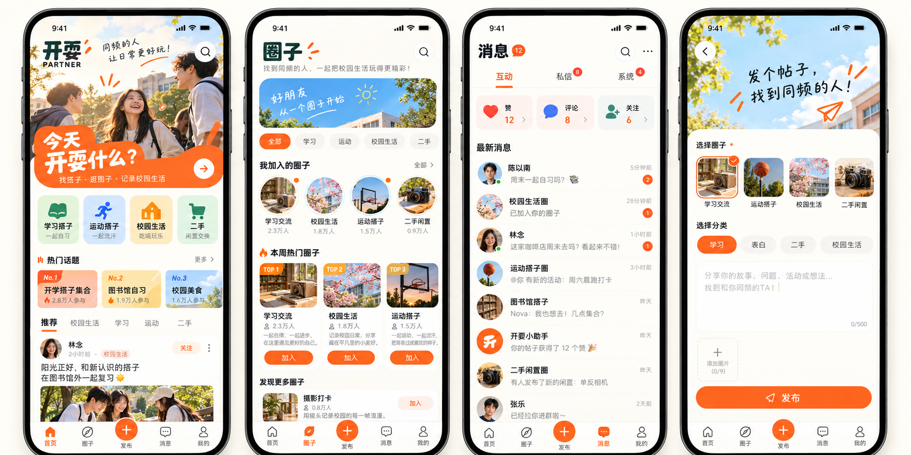

# “开耍”小程序品牌与 UI 开发基线

- **文档版本**：V1.1
- **文档状态**：Active（视觉方向已选定，M1 原生静态界面壳已实现，登录与业务接口待分阶段接入）
- **确认日期**：2026-10-20
- **最后核对**：2026-10-21
- **代码基线**：`apps/miniapp` M1 原生界面壳；阶段进展见 `docs/development/miniapp-development-progress-v1.md`
- **适用范围**：微信小程序品牌、信息架构、页面设计和分阶段开发

## 1. 已确认结论

1. 小程序中文名使用“开耍”。
2. 英文 `PARTNER` 作为辅助标识，不取代中文主品牌。
3. UI 采用已选定的橙绿校园社交方向：暖白底色、橙色行动按钮、深绿色辅助色、校园生活图片与轻量手绘标记。
4. 图标采用“橙色圆角方形 + 打开的门 + 星光 + 长投影”的方向。
5. 一级导航使用“首页 / 圈子 / 发布 / 消息 / 我的”。
6. V1 先完成已有社区数据可以支撑的闭环，不把概念稿里的所有内容都视为已实现功能。
7. 微信小程序 AppID 已准备；真实值不写入本文或公开仓库。
8. 确认新增“运动搭子”作为第四个预设圈子，具体 seed 和接口验证尚未实施。

### 1.1 决策状态

| 状态 | 内容 |
|---|---|
| 已确认 | 中文名、英文辅助标识、橙绿校园视觉方向、门与星光图标方向、五项一级导航、V1 使用微信原生小程序（TypeScript + WXML + WXSS）、AppID 已准备、新增运动搭子圈 |
| 待定稿 | 精确色值、字体、口号、SVG 图标、热门排序规则和具体构建配置 |
| 非 V1 | 实时私信、群聊、活动报名、位置匹配、关注关系和推荐算法 |

## 2. 视觉参考

### 2.1 小程序页面方向



图中四个页面确定了整体视觉、信息密度和主要交互层级；它是设计参考，不是可直接发布的页面截图。

### 2.2 图标方向


参考图存在 AI 生图文字伪影，图中部分字形近似“开要”。这不是品牌名称变更。正式代码、文案和矢量资产必须统一使用“开耍”。

当前 PNG 仅用于记录方向，不直接作为生产图标。正式图标需要重新绘制为可缩放矢量源文件，并导出微信小程序需要的不同尺寸；图标本体不应包含小字号 `PARTNER`，避免缩小后不可读。

## 3. 品牌规则

### 3.1 名称层级

| 层级 | 内容 | 使用方式 |
|---|---|---|
| 中文主品牌 | 开耍 | 图标旁、启动页、分享卡片和页面标题优先展示 |
| 英文辅助标识 | PARTNER | 只在空间充足的品牌区使用，不作为导航标题 |
| 技术标识建议 | `kaishua-miniapp` | 目录、包名或内部项目名；避免只使用过于通用的 `partner` |
| 候选口号 | 同频的人，让日常更好玩 | 当前视觉稿文案，正式上线前再确认 |

正式上线前仍需完成小程序名称、商标、域名和社交账号的可用性核验；本文不代表名称已注册成功。

### 3.2 视觉令牌草案

以下颜色根据概念图整理，用于第一版 UI 实现时校准，不是最终品牌色卡：

| 用途 | 建议值 | 说明 |
|---|---|---|
| 主行动色 | `#FF641E` | 发布、加入、选中态和主要 CTA |
| 品牌深绿 | `#174C3B` | 品牌文字、次级图标和稳定信息 |
| 暖白背景 | `#FFF9F1` | 页面主背景，避免纯白带来的冷感 |
| 主文字 | `#1D211F` | 标题和正文 |
| 天空蓝 | `#76C7F2` | 圈子封面、插画和轻量信息提示 |
| 未读红 | `#FF4D36` | 未读角标与需要注意的状态 |

组件默认使用 12、16、24 设计像素三级圆角。实现时根据设计稿宽度统一换算为 WXSS `rpx`，不直接把设计像素当作所有设备上的固定物理像素。橙色只突出关键动作，不大面积铺满信息流；卡片阴影保持轻量，以边框、底色和留白完成主要层级。

## 4. 产品定位与 V1 边界

“开耍”当前定位为面向校园用户的轻社区：用户加入后台维护的圈子，浏览和发布帖子，并通过点赞、评论和消息通知找到同频的人。

V1 不默认扩展为完整的活动平台或匹配平台。以下能力需要单独确认后才能设计数据模型：

- 活动创建、报名、候补和签到。
- 基于位置或学校的自动匹配。
- 推荐算法和个性化画像。
- 用户关注关系。
- 实时私信、群聊和消息撤回。
- 评论回复、评论点赞和多级评论。

概念图中的“关注”“热门参与人数”“添加图片”“私信”等内容包含视觉占位。开发时必须按下文状态表决定是接真实接口、隐藏入口，还是进入后续阶段。“运动搭子”已经从视觉占位转为已确认产品项，但在 seed、接口和测试完成前仍属于待实现能力。

## 5. 信息架构

```text
开耍
├── 首页
│   ├── 品牌与搜索
│   ├── 快捷分类
│   ├── 热门话题
│   └── 帖子信息流
├── 圈子
│   ├── 我的圈子
│   ├── 热门圈子
│   └── 发现更多圈子
├── 发布
│   ├── 选择圈子
│   ├── 选择分类
│   ├── 编辑内容
│   └── 提交发布
├── 消息
│   ├── 互动
│   ├── 私信（V2，占位不展示）
│   └── 系统
└── 我的
    ├── 个人资料
    ├── 我的帖子
    ├── 我的圈子
    └── 设置与安全
```

底部导航固定为五项。发布位于中间并使用橙色圆形强调；未读数量显示在“消息”导航和对应消息分类上。

## 6. 页面设计与真实能力映射

### 6.1 首页

完整概念方向包括：

1. “开耍 / PARTNER”品牌区、搜索入口和一句短口号。
2. “今天开耍什么？”主行动卡，进入圈子发现或发帖。
3. 快捷入口，首批只使用已有分类或圈子能支撑的内容。
4. 热门话题区。候选方案是按近期帖子数、点赞数和评论数计算，但排序窗口和权重尚未确认，不能直接按视觉稿编码。
5. 帖子信息流，展示作者、圈子、分类、发布时间、正文摘要和互动数量。

列表项点击进入帖子详情；点赞在卡片上提供即时反馈，失败时恢复原状态并显示错误提示。

当前帖子接口不支持关键词搜索，也没有热门聚合接口。对应入口应在接口落地前隐藏，不能做成点击无响应的正式功能。

### 6.2 圈子

页面结构：

1. 顶部搜索与分类筛选。
2. “我的圈子”横向列表。
3. “本周热门圈子”和普通发现列表。
4. 圈子卡片展示封面、名称、简介、成员数、帖子数和加入状态。

圈子仍由管理后台创建和维护，小程序用户不能创建圈子。加入、退出和重新加入必须复用现有成员关系规则。

圈子搜索、分类筛选、“本周热门”、帖子数和热度统计都需要在圈子 API 设计时明确返回字段与排序规则；概念稿本身不构成接口契约。

V1 圈子页只承诺：我的圈子、可加入圈子、名称、简介、成员数、加入状态，以及加入/退出操作。搜索、分类筛选、本周热门和帖子数在接口未落地时隐藏；封面没有正式媒体时统一使用项目内置占位图，不能使用伪造的远程图片或假统计数据。

预设圈子目标集合为“学习、表白、二手、运动搭子”。当前数据库和 seed 仍只有前三项；“运动搭子”必须在 M2 通过幂等 seed、接口和 smoke 验证后，才能在小程序正式展示。

### 6.3 帖子详情

概念总览图没有单独展示帖子详情，但它是 V1 必需页面：

- 完整正文、作者、圈子和分类。
- 点赞与取消点赞。
- 一级评论列表、发布评论和作者删除自己的评论。
- 作者删除自己的帖子。
- 被隐藏、删除或所属圈子不可见时显示稳定的不可用状态。

### 6.4 发布

现有服务端创建帖子时要求用户已加入所选圈子，并同时提供 `circleId`、`categoryId` 和内容。因此发布页的圈子与分类均为必选项。

第一阶段只开放纯文字发布：

- 圈子选择器只展示用户已加入且可用的圈子。
- 分类选择器使用启用且未删除的分类。
- 文本为空时不允许提交。
- 提交期间禁用重复操作；成功后进入帖子详情或返回首页并刷新。
- 图片入口在对象存储落地前不展示为可用功能。

### 6.5 消息

消息页沿用概念稿的三段结构，但分阶段实施。

#### V1：互动与系统通知

- 点赞了你的帖子。
- 评论了你的帖子。
- 管理或系统通知。
- 未读数量、单条已读和全部已读。

V1 不需要 WebSocket。页面进入、下拉刷新和小程序重新前台时拉取未读数量即可，先避免引入实时连接和额外运维复杂度。

#### V2：私信

私信只有在以下规则确认后实施：

- 谁可以向谁发消息，是否要求同圈或双方同意。
- 拉黑、举报、防骚扰和频率限制。
- 文本与媒体内容审核。
- 会话删除、消息保留周期和管理员调查边界。

在这些规则确认前，概念稿中的私信列表只保留为后续设计方向，V1 不伪造可用入口。

M1–M3 的内部开发版本可以显示明确的“消息建设中”空页面用于联调导航；对外发布的 V1 必须完成 M4 的真实互动/系统通知，不能交付无效入口。

### 6.6 我的

“我的”虽然未出现在四页视觉展开图中，但属于一级导航，至少包括：

- 昵称填写和默认头像。
- 我的帖子。
- 我的圈子。
- 退出当前设备登录或重新执行微信登录。
- 隐私政策、用户协议与反馈入口。

M1 先使用默认头像并允许填写昵称；头像选择与永久上传随 M5 对象存储一起实施。“退出当前设备”表示清除本地 JWT，下一次访问受保护页面时重新执行 `wx.login`；它不等同于注销账号。不默认收集手机号、邮箱、真实姓名和学校信息。

## 7. 当前实现状态

下表依据 2026-10-21 的 `apps/miniapp` 和服务端代码核对；继续接口开发前仍需同步目标分支并重新检查。

| 能力 | 状态 | 说明 |
|---|---|---|
| 小程序前端 | M1 静态壳已实现 | `apps/miniapp` 已包含原生 TypeScript、WXML、WXSS 工程、五项自定义 tabBar 和帖子详情页；当前只使用明确标注的本地演示数据 |
| 小程序用户、圈子、成员、分类、帖子、媒体、点赞、评论表 | 已实现 | PostgreSQL migration 和 Drizzle Schema 已存在 |
| 小程序分类查询 | 已实现 | `GET /api/miniapp/categories` |
| 帖子列表与详情 | 接口级已实现 | 需要小程序 JWT；真实登录完成前不能端到端使用 |
| 纯文字发帖和作者删除 | 接口级已实现 | 必须已加入圈子；真实登录和圈子查询完成前不能端到端使用 |
| 帖子点赞与取消点赞 | 接口级已实现 | 已有接口和计数返回；真实登录完成前不能端到端使用 |
| 一级评论与作者删除 | 接口级已实现 | 不支持回复、编辑或评论点赞 |
| 小程序 JWT 校验 | 部分实现 | Guard 已有；微信登录和签发流程未实现 |
| 小程序圈子列表、详情、加入、退出 | 已设计待实现 | 后台圈子管理已实现 |
| 头像、圈子封面、帖子媒体上传 | 未实现 | 对象存储尚未确定 |
| 互动与系统通知 | 未设计/未实现 | 需要新增契约、数据表和接口 |
| 用户私信 | 非 V1 | 需要先确认安全与治理规则 |
| 首页/圈子关键词搜索 | 未实现 | 正式版本在接口完成前隐藏入口 |
| 热门话题/热门圈子排序 | 未确认 | 需要先确认时间窗口、指标和接口 |
| 关注关系 | 非 V1 | 概念稿中的“关注”按钮不进入当前开发 |
| 自定义五项底部导航 | M1 已实现 | 首页、圈子、发布、消息、我的可在微信开发者工具切换，中间突出发布按钮已落地 |
| 昵称资料与默认头像 | M1 演示态已实现 | 当前为不采集个人信息的演示身份；微信登录、真实昵称与永久头像仍待实现 |
| 隐私政策、用户协议和反馈入口 | 未实现 | 对外发布前必须完成 |
| “运动搭子”预设圈子 | 已确认待实现 | 当前 seed 仍只有学习、表白、二手 |

## 8. 技术实现方向

### 8.1 前端选型

V1 已确认使用微信原生小程序：TypeScript + WXML + WXSS。

原因：

- 当前只明确支持微信小程序，没有跨端需求。
- 原生登录、头像选择、上传和审核行为更直接。
- 避免为第一版增加 Taro、uni-app 或额外 React 构建链。
- 页面数量和交互复杂度尚不需要大型前端框架。

如果后续确认同时发布 H5、支付宝小程序或 App，再通过 ADR 重新评估跨端框架，不在 V1 预先增加复杂度。

### 8.2 目录建议

```text
apps/miniapp/
├── app.ts
├── app.json
├── app.wxss
├── project.config.json
├── pages/
│   ├── home/
│   ├── circles/
│   ├── publish/
│   ├── messages/
│   ├── profile/
│   └── post-detail/
├── components/
│   ├── post-card/
│   ├── circle-card/
│   ├── empty-state/
│   └── load-state/
├── api/
│   ├── request.ts
│   ├── auth.ts
│   ├── posts.ts
│   └── circles.ts
├── state/
│   └── session.ts
├── types/
│   └── api.ts
└── assets/
```

只在出现重复后提取组件。V1 不建立独立 UI 组件包，也不让小程序直接依赖服务端源码或 Drizzle Schema。

`notifications.ts` 在 M4 的通知契约确认后再增加，不提前创建空文件或空抽象。

### 8.3 请求与认证

```text
wx.login
  → POST /api/miniapp/auth/login
  → 服务端调用微信 code2Session
  → 创建或更新 miniapp_users
  → 签发 aud=miniapp 的小程序 JWT
  → 小程序后续请求携带 Authorization: Bearer <token>
```

后台 JWT 与小程序 JWT 必须保持隔离。小程序不得保存或接触 AppSecret、`session_key` 或数据库身份字段。

小程序 Guard 在每次受保护请求中读取用户状态和 `token_version`；管理员禁用用户或递增版本后，旧 JWT 应立即失效，而不是只等待令牌自然过期。

请求层统一处理：

- API 基础地址和不同环境配置。
- Bearer Token 注入。
- `401` 重新登录和单次请求重放边界。
- 标准错误结构、超时、取消和弱网提示。
- BIGINT ID 始终按十进制字符串处理。

### 8.4 通知模块草案

实现消息 V1 前先补充正式数据库和 API 设计。最小模型可以围绕以下信息展开，不在本文直接冻结字段：

- 接收用户。
- 可选触发用户。
- 通知类型：点赞、评论、系统。
- 关联资源类型和字符串 ID。
- 展示摘要。
- 已读时间和创建时间。

候选接口：

```http
GET  /api/miniapp/notifications?page=1&pageSize=10&type=interaction
GET  /api/miniapp/notifications/unread-count
POST /api/miniapp/notifications/:id/read
POST /api/miniapp/notifications/read-all
```

最终字段、索引、权限和错误码需要在编码前写入社区数据库与 API 文档，并遵守 BIGINT、软删除和状态约定。

## 9. 分阶段开发计划

### M0：品牌资产定稿

- 校正“开耍”字形，绘制 SVG 图标和中文/英文组合标。
- 确认主色、字体、启动页和分享卡片规则。
- 核验名称与商标可用性。

名称和商标核验不阻塞内部原型开发，但属于公开发布和正式宣传的上线门禁。

### M1：小程序壳与登录

- [x] 创建 `apps/miniapp` 原生工程。
- [x] 实现首页、圈子、发布、消息、我的和帖子详情的静态界面壳。
- [x] 实现五项自定义 tabBar 和中间突出发布按钮。
- [x] 使用本地演示数据完成页面切换、点赞反馈、圈子加入反馈和发布校验演示；所有未接入能力均显式标注。
- [x] 使用本地忽略的 `project.config.json` 保存真实 AppID，仓库只提交占位配置模板。
- [ ] 完成环境配置、请求层、登录态和基础空/错/加载状态。
- [ ] 实现微信登录签发接口和小程序用户资料页。
- [ ] 增加隐私政策、用户协议和反馈入口骨架，正式内容在上线前确认。
- [ ] 验证后台 JWT 与小程序 JWT 不能越权互用。

原计划中的以下事项尚未完成，不能因静态界面可运行而标记为已实现：

- 登录、请求层和真实用户资料。
- 圈子、帖子、点赞、评论和通知接口联调。
- 正式图片上传、搜索、热门排序、关注和私信。

### M2：圈子闭环

- 实现小程序圈子列表、详情、加入、退出和我的圈子接口。
- 通过幂等 seed 新增“运动搭子”，同步数据文档并补充接口/smoke 验证。
- 完成圈子页以及发布页圈子选择。
- 保持圈子只能由后台创建的现有边界。
- V1 只展示名称、简介、成员数和加入状态；无正式封面时使用本地占位图，搜索、分类筛选、热门和帖子数入口暂时隐藏。

### M3：社区内容与发布闭环

- 首页帖子列表和现有条件筛选。
- 帖子详情、点赞、一级评论和作者删除。
- 基于“我的圈子”的纯文字发布。
- 复用现有服务端接口，不先加入媒体上传、搜索和热门聚合。

### M4：消息 V1

- 确认通知数据模型与 API 契约。
- 实现点赞、评论和系统通知。
- 完成未读角标、已读状态、空状态和分页。

### M5：媒体与增强功能

- 对象存储、上传授权、文件类型/大小校验和内容审核。
- 头像、圈子封面、图文和视频帖子。
- 根据真实需求决定是否进入私信、活动和推荐能力。

公开发布的 V1 包含 M0–M4，并要求名称门禁、隐私政策、用户协议和真机验收完成。M5 属于 V1 之后的增强，不阻塞纯文字社区第一版发布。

## 10. 验收标准

V1（M0–M4）可以对外交付时，应至少满足：

- 五项底部导航在真机安全区内显示正常。
- 微信登录、重新登录和禁用用户失效流程可验证。
- 首页 → 详情 → 点赞/评论 → 发布形成真实闭环。
- 未加入圈子不能发帖，停用或删除圈子不出现在小程序中。
- 发布页在媒体未配置时不伪装成可以上传图片或视频。
- 列表具有加载、空数据、失败、重试和到底状态。
- 未读角标来自服务端数据，不能只保存在本地。
- 中文品牌始终显示为“开耍”，不存在“开要”等错误字形。
- 服务端类型检查、后台类型检查、全量构建和数据库 smoke 通过。
- 在微信开发者工具和至少一台真机验证核心流程。

## 11. 已确认与剩余门禁

### 11.1 本轮已确认

- 微信小程序 AppID 已准备。本文不记录真实值；AppSecret 也不得提交到仓库。
- “运动搭子”作为第四个预设圈子进入 M2，当前只是产品确认，尚未修改数据库或 seed。
- 概念稿中的“关注”从 V1 删除；当前系统没有关注关系。

### 11.2 仍需确认

1. `[M0 上线门禁]` “开耍”是否长期限定校园场景，还是未来扩展到城市兴趣搭子。
2. `[M4 开工门禁]` V1 消息页只做互动/系统通知；私信是否继续明确延期。
3. `[后续增强]` 首页“热门话题”使用何种可解释排序规则；M3 不实现热门聚合。
4. `[M1 开工门禁]` AppID 已准备；仍需在安全环境中配置 AppSecret、JWT 有效期和合法域名。
5. `[M5 开工门禁]` 对象存储供应商、内容审核和用户举报/拉黑边界。

## 12. 文档维护规则

- 本文记录产品与 UI 基线，不替代数据库、API 和实施状态文档。
- 如果社区身份、表关系、状态或接口发生变化，必须同步更新现有架构、API 和 TODO 文档。
- 视觉稿中的占位能力只有在代码、接口、测试和状态文档同时完成后，才能改为“已实现”。
- 正式矢量图标完成后，用生产资产替换本页图标参考图，但保留版本历史。
